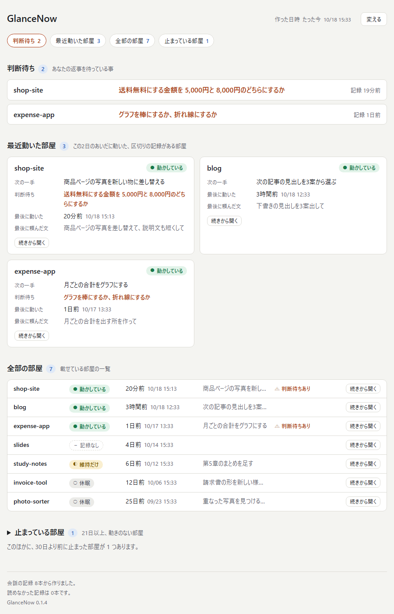

# GlanceNow（仮の名前）

作業フォルダ（以下「部屋」）ごとの今を、1枚の画面にまとめて出す、Claude Code 用のプラグインです。

- 版：0.1.5（試作）
- 確かめた環境：Windows 11・Claude Code 2.1.296（端末）と 2.1.295（デスクトップアプリ）・Python 3.14.3・Git Bash あり（2026-10-14）。入れ方と動きは、2.1.201 でも確かめました（2026-10-13）
- ほかの環境では、まだ動かしていません（下の「分かっている限界」）

画面の見本です。部屋の名前・頼んだ文・次の一手は、見本のために作った例です（明るい画面。設定で暗い画面にもできます）。

## 何をするか

- Claude Code の会話の記録を読んで、会話をしたフォルダを「部屋」として見つけます。
- 部屋ごとに、次の5つを1枚の HTML の画面に出します。
  - 最後に動いた日時・最後に頼んだ文（会話の記録から読みます）
  - 状態・次の一手・判断待ち（「区切り」と言った時と、区切りのスキルが動いた返事の終わりに記録します）
- 節は4つです：判断待ち／最近動いた部屋（この2日に動いた、区切りの記録がある部屋をカードで）／全部の部屋（1部屋1行）／止まっている部屋。
- 部屋ごとの「続きから開く」を押すと、その部屋で最後の会話の続きを始める行（`cd "<部屋の場所>"; claude --continue`）がコピーされます。端末に貼って実行します。
- 画面は、会話の始まり・質問を送った時・返事が終わった時に、元が変わっていれば作り直します。時間で動く仕組みはありません。
- 会話を待たせる処理は2つです。
  - 会話の始まり：最初の案内を AI に渡す処理（Python の起動と小さなファイルの読み書きだけ）。
  - 返事が終わる時：区切りのスキルが動いた後に、1行がまだ書かれていないかを見る処理（0.1.3 から）。印が無い時は、bash の中でフォルダを1つ見るだけで、Python を起動しません。
  - 会話の記録を全部読む処理と、質問を送った時・スキルが動いた直後・返事が終わった時の画面の処理は、裏で走ります。
- 画面の中身（載せる部屋・並び・出す項目・節・見た目）は、使う人が変えられます。

外へは何も送りません。ネットワークを使う処理は入っていません。書き込む場所は、下の「置き場所」のフォルダ1つだけです。

## 動く条件

| 要る物 | 確かめた版 | 補足 |
|---|---|---|
| Claude Code | 2.1.296・2.1.295・2.1.201 | プラグインとフックが使える版。版で違った所は「入れ方」に書きました |
| Python 3 | 3.14.3 | `python3` か `python` で呼べること。追加で入れるライブラリはありません |
| Git Bash（Windows の時） | あり | Git for Windows に入っています。フックのコマンドを bash の書き方で書いているためです |

## 入れ方

### GitHub から入れる

    claude plugin marketplace add glancenow/glancenow
    claude plugin install glancenow@glancenow

- 1行目で、このリポジトリを「プラグインの置き場」として Claude Code に登録します。2行目で、そこから GlanceNow を入れます。どのフォルダで打っても、全部の部屋に入ります。
- `git` が要ります。GitHub のアカウントは要りません（公開のリポジトリです）。
- Claude Code は、先に SSH で取りに行き、だめなら HTTPS で取りに行きます（公式の説明）。GitHub の SSH の鍵を持っていない時は、先に環境変数 `CLAUDE_CODE_PLUGIN_PREFER_HTTPS=1` を決めておくと、最初から HTTPS で取りに行きます（公式の説明では、会話の中の `/plugin` から入れる時と、更新の時は、この切り替えが起きないため）。
- 確かめた事：2026-10-18 に、Claude Code 2.1.296・Windows 11 で、本物の設定に触れない一時の設定フォルダを使い、SSH の時と `CLAUDE_CODE_PLUGIN_PREFER_HTTPS=1` の時の両方で、2行とも通りました（`claude plugin list` に `glancenow@glancenow`・0.1.3・enabled）。
- 新しい版に替える時は、`claude plugin marketplace update glancenow` → `claude plugin update glancenow@glancenow` の2行です。

### フォルダから入れる

このフォルダ（この `README.md` があるフォルダ）を、自分のPCの好きな場所に置いてから進めます。
下の `<このフォルダの場所>` は、置いた場所に読み替えます。

#### 1回の会話だけで試す

    claude --plugin-dir <このフォルダの場所>/glancenow

その会話の間だけ、プラグインが読み込まれます。Claude Code の設定には何も書かれません。

#### 入れる（どの会話でも動くようにする）

    claude plugin marketplace add <このフォルダの場所>
    claude plugin install glancenow@glancenow

- 1行目で、このフォルダを「プラグインの置き場」として Claude Code に登録します。2行目で、そこから GlanceNow を入れます。
- 入れた後に開いた会話から動きます。開いたままの会話では、`/reload-plugins` と打つと読み込まれます。
- 入れた後で、このフォルダを動かしたり消したりしないでください（置き場の登録が、このフォルダを指しています）。
- 入れたプラグインは、このフォルダから直接読み込まれます。2.1.296 では、`claude plugin list` の「Read from」の行がこのフォルダを指し、入れた後にもう一度 `install` を打つと「このフォルダから読み込むので、中の変更は次の会話の始まりか `/reload-plugins` で効く」という意味の文が出ました。＝このフォルダの中身を変えると、入れ直さなくても、次に開く会話から変えた中身で動きます。作っている途中の物を、このフォルダに置かないでください。
- 2.1.201 では、入れる時に中身が `.claude/plugins/cache`（ホームフォルダの下）へコピーされました。2.1.296 でも、このコピーは作られます。
- 入った事を確かめる：`claude plugin list`（`glancenow@glancenow` が `enabled` と出ます）

#### 1つの部屋だけに入れる

    cd <部屋の場所>
    claude plugin marketplace add <このフォルダの場所> --scope local
    claude plugin install glancenow@glancenow --scope local

- その部屋で開いた会話だけで、フックが動きます。書かれるのは、その部屋の `.claude/settings.local.json` だけです（ホームフォルダの下の Claude Code の設定には書かれません）。
- 画面には、ほかの部屋も載ります（会話の記録は、全部の部屋の分を読みます）。ほかの部屋で「区切り」と言っても、その部屋のカードの状態・次の一手は変わりません。

#### 1つの部屋から、全部の部屋へ広げる

    cd <1つの部屋だけに入れた部屋の場所>
    claude plugin marketplace update glancenow
    claude plugin install glancenow@glancenow
    claude plugin uninstall glancenow@glancenow --scope local

- 3行とも、1つの部屋だけに入れた部屋のフォルダで打ちます（1行目の `cd`）。最後の行は、打ったフォルダの分だけを探すので、ほかのフォルダで打つと「入っていない」と出て失敗します（確かめたPCで2回）。
- 終わると、全部の部屋の分が1つだけ残ります（`claude plugin list` で Scope が `user`）。ホームフォルダの下の Claude Code の設定に足されるのは、GlanceNow を有効にする1行だけでした。
- 最後の行を打たなくても動きますが、部屋だけの分と全部の部屋の分が並び、新しい版に替える時の行が2倍になります。

#### 新しい版に替える

置き場のフォルダ（入れる時に登録したフォルダ）の中身を、新しい版の中身に置き換えてから、次の2行を打ちます。

    claude plugin marketplace update glancenow
    claude plugin update glancenow@glancenow

- 2行目で「updated from 0.1.0 to 0.1.1」のように出ます（2.1.201 で確かめました）。
- 置き場のフォルダは直接読み込まれるので（上の「入れる」）、中身を置き換えた時点で、次に開く会話から新しい中身で動きます。置き換えは、新しい版の中身がそろってから、1回で済ませます。
- 入れる時に `--scope` を付けた時は、2行目にも同じ `--scope` を付けます。
- 設定・記録・画面（`.glancenow` フォルダ）は、そのまま残ります。

## 使い方

### 最初の質問（1回だけ）

入れた後の最初の会話で、AI が「GlanceNow の設定の質問を、今しますか。あとでしますか。」と聞きます。

- 「今する」：最初に、決め方を選びます。どちらの時も、終わると画面が出来て、いつものブラウザにタブが足されます。
  - 「全部おまかせ」：質問は無く、標準の設定で画面が出来ます。
  - 「1つずつ答える」：次の6つの質問に答えます。どの質問も「標準のまま」を選べます。途中の問いに「おすすめで」と答えると、その問いだけ標準になり、次の問いへ進みます。
    1. 載せる部屋
    2. 並び
    3. 部屋ごとに出す項目
    4. 節の構成
    5. 見た目（明るい画面・暗い画面と、色）
    6. 文字の大きさ
- 「あとで」：案内は出なくなります。始める時は「GlanceNow の設定を始めて」と言うか、`/glancenow:setup` と打ちます。
- 最初の質問が済むまで、画面は作られません。
- 質問の前に、スキルを起動してよいかの確認（Execute skill: glancenow:setup）が出ます。許可を選んでください。

### ふだん

画面は1つのファイルです（下の「置き場所」の `glancenow.html`）。ブラウザで開いて見ます。ブックマークに入れておくと、すぐ開けます。

会話のたびに作り直されますが、開いたままの画面は自動では変わりません。読み込み直すと新しくなります。

### 区切り

作業の区切りで「区切り」と言うと、AI がその会話から、状態・次の一手・判断待ちを1行にまとめて記録します。記録は、その部屋のカードと「判断待ち」の節に出ます。

### 設定を変える

| 入口 | やり方 |
|---|---|
| AI に頼む | 「GlanceNow を暗い画面にして」のように言う |
| 自分で書く | 設定ファイル（`config.json`）を書き換える |
| 画面から | 画面の右上の「変える」を押す |
| 最初の質問をやり直す | 「GlanceNow の設定を始めて」と言う |

項目の一覧と書ける値は、`glancenow/docs/設定の書き方.md` にあります。

## 置き場所

GlanceNow が書くのは、ホームフォルダの下の `.glancenow` フォルダだけです。環境変数 `GLANCENOW_HOME` を決めると、そのフォルダに変わります。

| ファイル | 中身 |
|---|---|
| `glancenow.html` | 画面 |
| `config.json` | 設定（自分で書き換えてよい） |
| `config.lastgood.json` | 最後に読めた設定の控え |
| `records/<部屋のid>.md` | 「区切り」で書いた記録（1回に1行） |
| `rooms.json` | 見つけた部屋の一覧 |
| `scan_cache.json` | 会話の記録を読んだ結果の控え |
| `state.json` | 最初の質問が済んだか、などの状態 |
| `log.txt` | 動いた経過（512KB を超えると `log.old.txt` へ回します） |

- 読むだけの物：Claude Code の会話の記録（ホームフォルダの下の `.claude/projects`）。書き換えません。
- 作業フォルダの中には、何も足しません。
- 「最後に頼んだ文」は、会話で最後に送った文の先頭60字です。`rooms.json` と `scan_cache.json` に入ります。出さない設定にすると、控えるのをやめて、控えてあった文も消します。
- 画面のボタンで変えた事は、その画面を開いたブラウザの中に残ります。
- 入れた事そのもの（置き場の登録・プラグインを有効にした事）は、Claude Code が自分の設定に書きます。

## やめ方

    claude plugin uninstall glancenow@glancenow
    claude plugin marketplace remove glancenow

- 1行目でプラグインを外します。2行目で、置き場の登録を外します。
- 1つの部屋だけに入れた時は、その部屋のフォルダで、1行目に `--scope local` を付けて打ちます。
- 少しの間だけ止める時は `claude plugin disable glancenow@glancenow`、戻す時は `claude plugin enable glancenow@glancenow`。
- 設定・記録・画面は `.glancenow` フォルダに残ります。要らなければ、フォルダごと消します。
- `--plugin-dir` で試しただけの時は、外す操作は要りません。

## 分かっている限界

- 確かめた環境は、Windows 11 の1台だけです。Mac・Linux では動かしていません。Python は 3.14.3 で確かめました。3.9 などの古い版では動かしていません。
- Git Bash の無い Windows では動きません。
- スキル（setup・settings・checkpoint）を使う時に、起動してよいかの確認が出ます。
- 最初の質問が選択形式で出ない場面では、文で1問ずつ聞く形になります。この時は、2問目から、道具を実行してよいかの確認が出ます。
- PCがとても混んでいて、Python の起動だけで60秒を超える時は、会話の始まりの処理が Claude Code に止められ、最初の案内が出ません（止められても、失敗の知らせは出ません）。その時は「GlanceNow の設定を始めて」と言うと始められます。0.1.0 では、この制限が10秒で、会話の記録を全部読む処理も同じ10秒の中にあったため、混んでいるPCで案内が出ませんでした（確かめたPCで1回）。0.1.1 で、記録を読む処理を裏へ分けました。0.1.1 を入れた同じPCで、混んでいる時に、案内を渡す処理が 10.8秒かかり、案内は出ました（1回）。
- OS の一時フォルダの下で Claude Code を動かしたフォルダは、標準では部屋として載せません（0.1.2 から）。載せる時は、設定の `rooms.show_temp` を `true` にします。一時フォルダの場所の一覧は、道具の中に持っています。確かめたのは Windows の1台だけで、Mac・Linux の場所（`/tmp`・`/var/tmp`・`/var/folders`）は、動かして確かめていません。
- 一時フォルダの外にある試し用のフォルダは、道具からは本物の部屋と見分けられないので、部屋として載ります。載せたくない部屋は、設定の `rooms.hide` に書くか、AI に「GlanceNow で ◯◯ を隠して」と頼むか、画面の「変える」で隠します。最初の質問には、隠す選択肢がありません。
- 標準（この30日に動いた部屋を載せる）のままだと、30日より前に止まった部屋は載りません。その数だけを、「止まっている部屋」の節の終わりに1行で出します（0.1.2 から。部屋の名前は出しません）。部屋そのものを出したい時は、載せる部屋を「全部の部屋」にします。
- 画面を開く命令（`open`）は、ブラウザを手前に出さないことがあります。確かめたPCでは、後ろにあるブラウザの窓にタブが足されただけで、手前のアプリはそのままでした。開いたかを、道具は確かめません。最初の質問の終わりに、AI が「ブラウザの窓にタブが足されています」と、画面のファイルの場所を伝えます（0.1.2 から）。見当たらない時は、その場所のファイルを自分で開きます。
- 人が見ていない実行（`claude -p`）では、裏で走る処理が、終わる前に止められることがあります（公式の説明による。会話の記録を読む処理が途中で止まった時は、次の会話の始まりに読み直します）。
- 会話の記録の書式は、Claude Code の側の物です。書式が変わると、「最後に頼んだ文」が空になることがあります。
- 開いたままの画面は、読み込み直すまで古いままです。
- Claude Code は、古い会話の記録を消します（確かめたPCでは、30日より古い記録が消えました）。記録が消えた部屋は、GlanceNow の一覧に残り、「記録が消えた」の印が付きます。
- フォルダの名前や場所を変えた時に、前の部屋とつなぎ直す機能はありません。
- 下の階層のフォルダを、1つの部屋にまとめる機能はありません。
- スマホで見るための機能はありません。
- 「続きから開く」がコピーする行は、Windows では PowerShell と Git Bash の形（`cd "<場所>"; claude --continue`）です。コマンドプロンプト（cmd）では、そのままでは動きません。Mac・Linux では `cd <場所> && claude --continue` の形です（動かしては確かめていません）。デスクトップアプリで使う時は、この行は使えません。
- 作業フォルダの場所が1行も書かれていない会話の記録は、同じ記録のフォルダに場所の分かる部屋が1つだけある時、その部屋にまとめます（0.1.4 から。前の版では、記録のフォルダの名前のまま、別の部屋として出ていました）。
- 「区切り」という合言葉で動くスキルがほかにも入っている時は、ほかの方の手順を先に全部済ませてから、最後に GlanceNow の1行を書く、とスキルに書いてあります（0.1.2 から）。実際にどちらが、どの順で動くかは AI が選ぶので、いつもこの順になるとは限りません。確かめたのは、AI のモデル `claude-opus-5-5`（Claude Code 2.1.280 以上が要るモデル）で、メモを2行書くだけの短い「区切り」スキルと並べた3回だけです。3回とも、ほかの方 → GlanceNow の順に両方が動きました（2026-10-14）。GlanceNow の方だけを使う時は、`/glancenow:checkpoint` と打ちます。
- 「区切り」と言わずに、ほかの仕組み（フック・AI の判断）で区切りのスキルが動いた時は、AI が GlanceNow の1行を思い出さない事がありました（確かめたPCで、8時間に24回のうち0回。2026-10-14）。0.1.3 からは、区切りのスキル（設定の `checkpoint.after_skills`。標準は「区切り」）が動いた返事で、1行がまだ書かれていなければ、返事の終わりに GlanceNow が AI に1行を頼みます。その時、返事の一番最後は「記録しました…」の1行になります。頼むのは1回の区切りで1回だけです。最初の質問が済むまでは頼みません。スラッシュ（`/区切り`）で直接打った時は、スキルの道具を通らないので、頼みません。

## 作っている人向け

検査は3本です。このフォルダで実行します。どれも自分で一時フォルダを作るので、Claude Code の設定や本物の記録には触りません。

    python tests/check_scan.py
    python tests/check_page.py
    python tests/check_entry.py

プラグインと置き場の形を確かめる：

    claude plugin validate ./glancenow
    claude plugin validate .

`glancenow/scripts/.devguard` というファイルがある間は、`GLANCENOW_HOME` を決めないと動きません（作っている間に、標準の場所へ書かないための印です）。配る物には入れません（`.gitignore` に書いてあります）。

このフォルダをそのまま写して渡す時・自分のPCに入れる時は、次の物を除いたコピーを作り、そのコピーから入れます。除かないと、入れた先にも印が写り、何も書かれないまま動いていないように見えます（フックは失敗を出さずに終わります）。

- `glancenow/scripts/.devguard`
- `glancenow/scripts/.devguard.log`
- `__pycache__` のフォルダ

## ライセンス

MIT ライセンスです（`LICENSE`）。使う・直す・配るのは自由です。写して配る時は、`LICENSE` の作者の表示と文をそのまま残してください。動きは保証しません。
